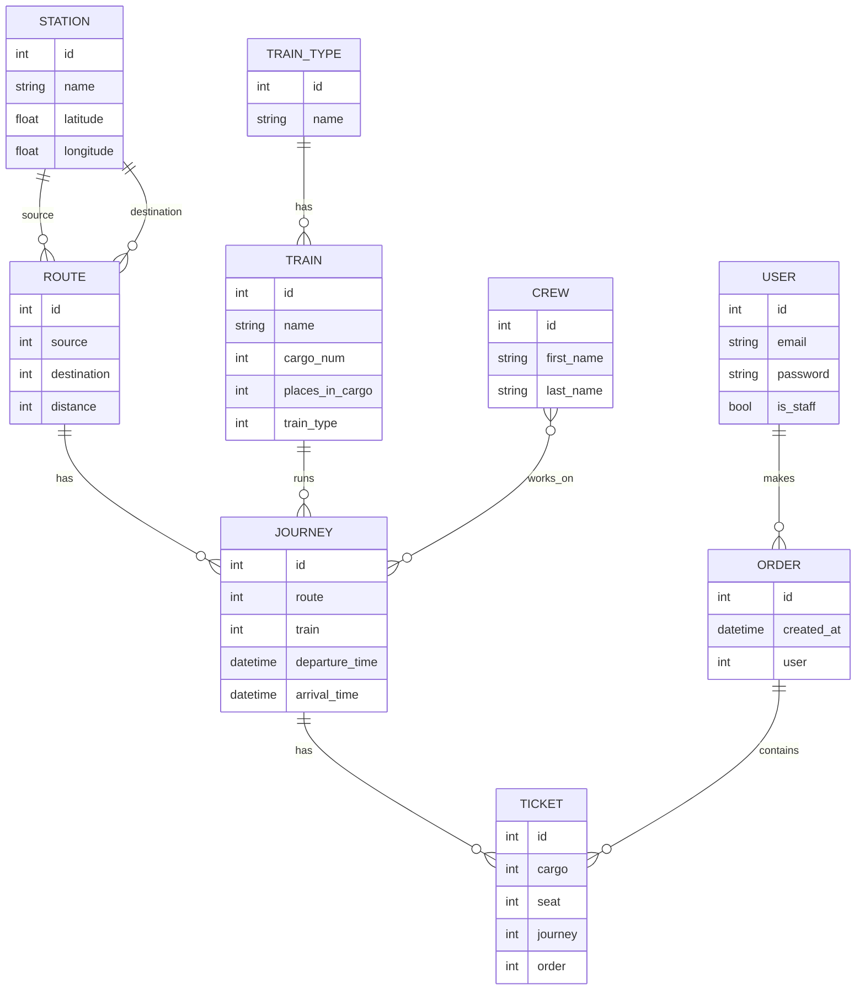
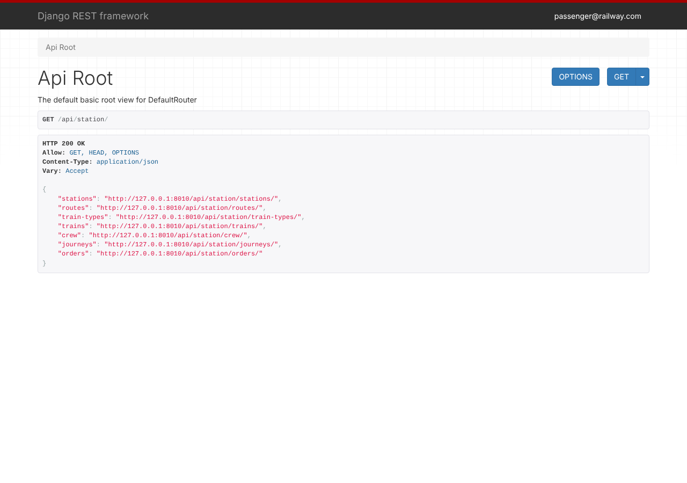
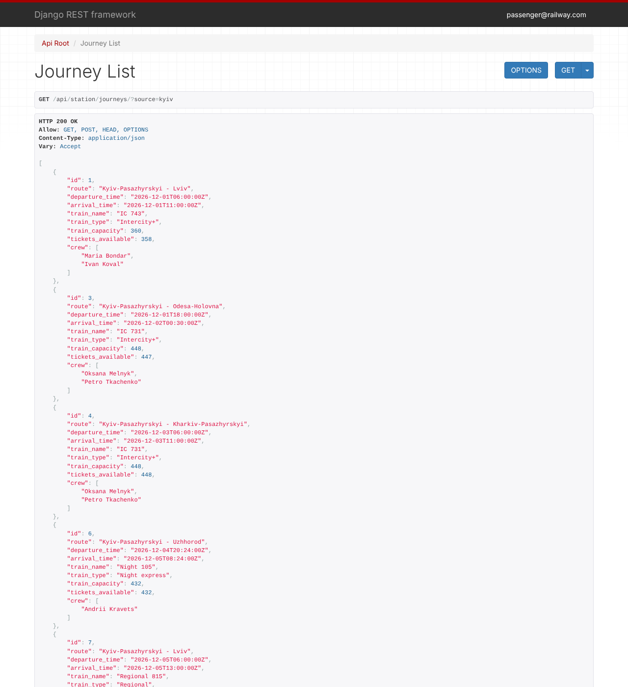
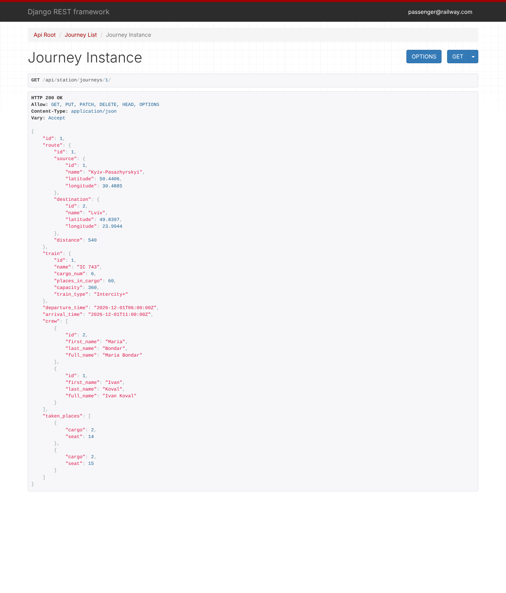
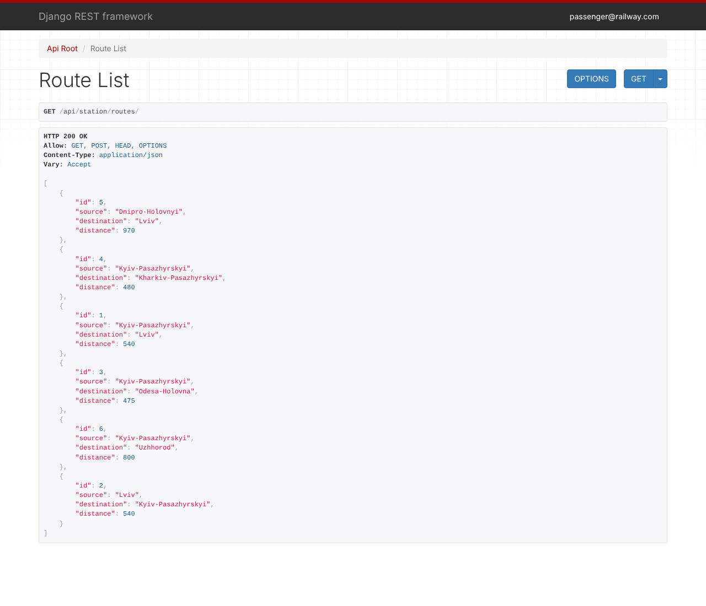
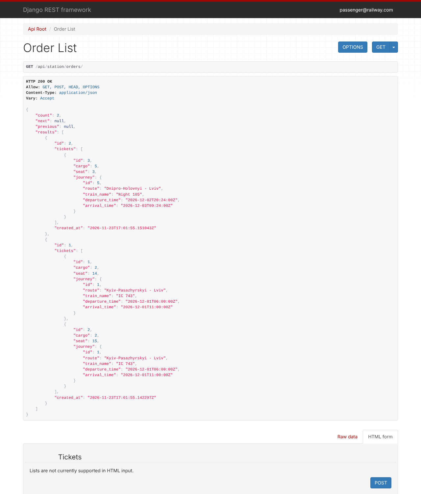
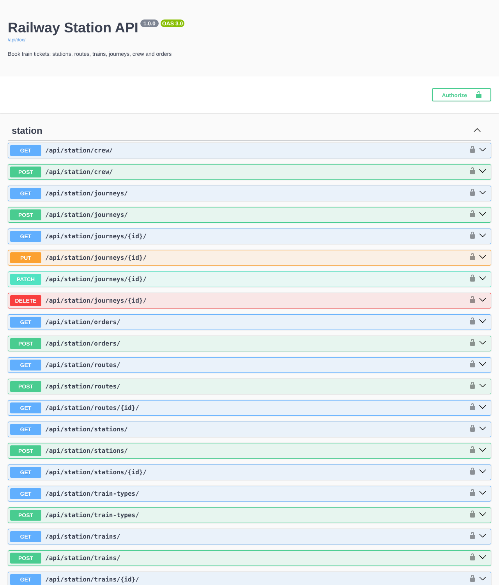

# Railway Station API

REST API for a railway station: passengers browse stations, routes and
journeys, see how many seats are still free and book tickets; admins manage
stations, trains, crew and the schedule.

Built with **Django REST Framework**, **PostgreSQL**, **JWT** and **Docker**.

## Features

- JWT authentication (`/api/user/token/`, `/api/user/token/refresh/`,
  `/api/user/token/verify/`), registration and profile (`/api/user/me/`)
- Login with **email** instead of username (custom user model)
- Admins create and edit stations, routes, train types, trains, crew and
  journeys; authenticated users have read-only access
- Orders with several tickets created in one transaction; every user sees
  only their own orders, paginated
- Seat validation: car and seat must exist in the train, one seat per
  journey can be sold only once
- Journey list shows `tickets_available` (train capacity minus sold
  tickets), journey detail shows `taken_places`
- Filtering:
  - journeys: `?source=`, `?destination=` (station name),
    `?date=YYYY-MM-DD`, `?train=<id>`
  - routes: `?source=`, `?destination=`
  - trains: `?train_type=<id>`
- Validation: route source differs from destination, arrival is after
  departure
- Swagger / Redoc documentation with all query parameters described
- Throttling: 30 requests/minute for anonymous, 100 for authenticated users
- Admin panel with inline tickets for orders
- Dockerized: app + PostgreSQL, `wait_for_db` command, named volume for data
- Tests for models, station API and user endpoints

## Database structure



## Run with Docker

Docker should be installed.

```shell
git clone https://github.com/KorJ4/railway-station-api.git
cd railway-station-api
cp .env.sample .env        # set your own SECRET_KEY and DB password
docker-compose up --build
```

Load demo data (optional):

```shell
docker-compose exec app python manage.py loaddata railway_station_db_data.json
```

The API is available at http://127.0.0.1:8000/api/station/ and the
documentation at http://127.0.0.1:8000/api/doc/swagger/.

## Run locally without Docker

PostgreSQL should be installed and a database created.

```shell
git clone https://github.com/KorJ4/railway-station-api.git
cd railway-station-api
python -m venv venv
source venv/bin/activate        # Windows: venv\Scripts\activate
pip install -r requirements.txt
cp .env.sample .env             # set POSTGRES_HOST=localhost and your DB data
export $(grep -v '^#' .env | xargs)
python manage.py migrate
python manage.py loaddata railway_station_db_data.json
python manage.py runserver
```

## Getting access

- Create a user: `POST /api/user/register/` with `email` and `password`
- Get tokens: `POST /api/user/token/` with `email` and `password`
- Send the access token in every request header:
  `Authorization: Bearer <access token>` (for the browser you can use the
  ModHeader extension)
- Refresh the access token: `POST /api/user/token/refresh/` with `refresh`

Demo users from the fixture:

| Role | Email | Password |
|------|-------|----------|
| Admin | `admin@railway.com` | `admin12345` |
| Passenger | `passenger@railway.com` | `passenger12345` |

## Endpoints

| Endpoint | Methods | Access |
|----------|---------|--------|
| `/api/station/stations/` | GET, POST, GET `<id>` | read: users, write: admin |
| `/api/station/routes/` | GET, POST, GET `<id>` | read: users, write: admin |
| `/api/station/train-types/` | GET, POST | read: users, write: admin |
| `/api/station/trains/` | GET, POST, GET `<id>` | read: users, write: admin |
| `/api/station/crew/` | GET, POST | read: users, write: admin |
| `/api/station/journeys/` | GET, POST, GET/PUT/PATCH/DELETE `<id>` | read: users, write: admin |
| `/api/station/orders/` | GET, POST | authenticated users, own orders only |
| `/api/user/register/` | POST | everyone |
| `/api/user/me/` | GET, PUT, PATCH | authenticated users |

Example of creating an order:

```json
POST /api/station/orders/
{
    "tickets": [
        {"cargo": 2, "seat": 10, "journey": 1},
        {"cargo": 2, "seat": 11, "journey": 1}
    ]
}
```

## Tests and code style

```shell
docker-compose run app sh -c "python manage.py test"
docker-compose run app sh -c "flake8"
```

## Screenshots

API root:



Journeys filtered by source with available tickets:



Journey detail with crew and taken places:



Routes:



User orders with pagination:



Swagger documentation:


